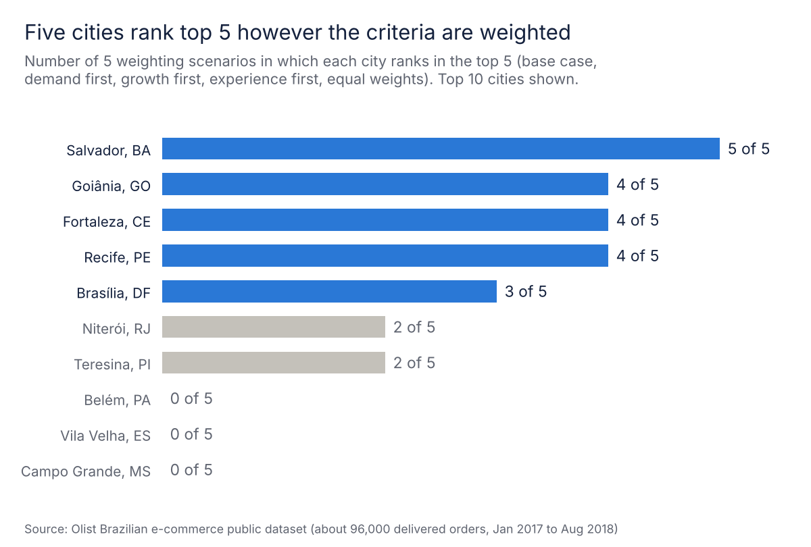
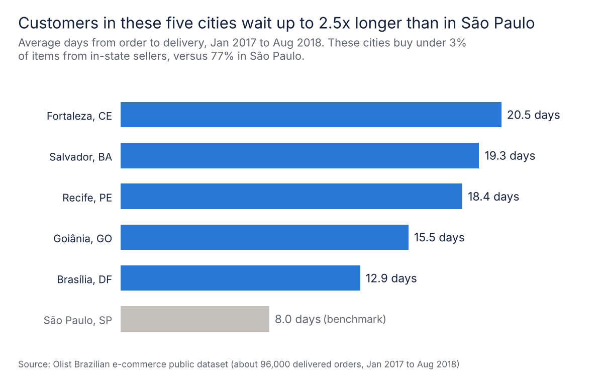
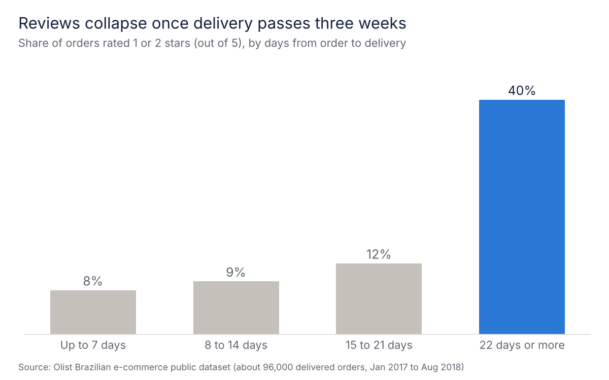

# City Expansion Scorecard: Where Should a Marketplace Launch Next?

A SQL-first analysis of ~96,000 real marketplace orders that ranks 68 cities on where a local launch (local seller recruitment plus local fulfilment) would create the most value, then turns the ranking into a launch sequence.

Built with **DuckDB SQL** (CTEs, window functions, scenario modelling) and Python for orchestration and charts.

## The question

Olist is a Brazilian e-commerce marketplace that connects small merchants with customers across the country. Almost every order ships long-distance, mostly from sellers in Sao Paulo state. If Olist could build local operations in five new cities, **which five, and in what order?**

This is the same decision a delivery marketplace makes when it chooses its next launch markets: where is demand already proven, where is it growing, where is the customer experience weakest today, and where is local supply missing?

## The recommendation

**Launch next in Goiania, Salvador, Brasilia, Fortaleza and Recife, starting with local seller recruitment rather than fulfilment centres.** Together they placed 5,112 delivered orders in the period, are growing 143% to 229% year over year, and buy almost nothing from sellers in their own state (0.6% to 2.6% of items). As a result, their customers wait 12.9 to 20.5 days for delivery, compared with 8.0 days in Sao Paulo.

| Rank | City | Launch score | Delivered orders | YoY growth | Same-state seller share | Avg delivery (days) | Late rate | Main reason to launch |
|---|---|---|---|---|---|---|---|---|
| 1 | Goiania, GO | 79.6 | 656 | 229% | 1.9% | 15.5 | 11.6% | Fastest-growing demand |
| 2 | Salvador, BA | 78.1 | 1,188 | 152% | 1.6% | 19.3 | 17.5% | Large existing demand |
| 3 | Brasilia, DF | 76.5 | 2,065 | 198% | 2.6% | 12.9 | 7.1% | Large existing demand |
| 4 | Fortaleza, CE | 75.9 | 614 | 143% | 0.6% | 20.5 | 18.1% | Slow, unreliable delivery today |
| 5 | Recife, PE | 75.1 | 589 | 165% | 0.9% | 18.4 | 13.4% | Underserved by local sellers |

Reference point: across all 68 eligible cities the median is 11.3 delivery days, an 8.3% late rate and 157% growth.

Four further findings shape the plan:

- **These picks are robust.** All five stay in the top 5 under at least three of five weighting scenarios, and all five stay in the top 11 under every scenario (see *Is the ranking robust?*)
- **Rio de Janeiro is a cluster play.** Niteroi (#6), Rio de Janeiro (#14) and Nova Iguacu (#15) all rank well and share one metro area. One Rio launch team could serve all three, which makes it the natural Wave 2 anchor even though Rio city alone ranks lower
- **Launch with local sellers first, not warehouses.** Shifting a quarter of these cities' orders to sellers in the same state would save about **BRL 12,500 a year in freight, cut each of those deliveries by about 7 days, and avoid about 42 one- or two-star reviews a year** at 2018 volumes (see *What is a faster delivery worth?*). That pays for seller recruitment, not a fulfilment centre. Revisit physical fulfilment once volume in a city is several times higher
- **The prize is experience, not repeat revenue.** Late orders get a 1 or 2 star review 57% of the time against 10% for on-time orders in the same city, but customers whose first order arrived late come back at almost the same rate (1.7% against 2.0% within 180 days). Few Olist customers ever reorder, so faster delivery protects marketplace ratings and seller reputation more than it drives repeat sales

The full 15-city sequence, with launch waves and launch mode (standalone or extend from an anchor city), is in [`results/launch_waves.csv`](results/launch_waves.csv).

## Charts



The top five are not just the highest scores. They stay on top when the weights change, while the next-best cities (Niteroi, Teresina) only make the top 5 in two of five scenarios.



That is the opportunity: customers in these cities already order a lot and keep ordering more, but almost everything ships from out of state, so deliveries take two to three weeks.

## What is a faster delivery worth?

The ranking says where. This section asks whether it is worth doing, using every delivered order rather than city averages ([`sql/09_size_the_prize.sql`](sql/09_size_the_prize.sql)).



**Same-state orders are cheaper, faster and better reviewed**

| Seller location | Orders | Freight per order | Delivery days | Late rate | 1 or 2 star reviews |
|---|---|---|---|---|---|
| Out of state | 61,280 | BRL 26.96 | 15.0 | 9.1% | 14.2% |
| Same state | 34,280 | BRL 15.39 | 7.8 | 6.0% | 10.3% |

**Scenario: 25% of each launch city's orders move to same-state sellers (2018 run rate)**

| City | Orders a year | Same-state share today | Orders shifted | Freight saved (BRL a year) | Bad reviews avoided a year |
|---|---|---|---|---|---|
| Brasilia, DF | 1,790 | 2.6% | 447 | 5,176 | 17 |
| Salvador, BA | 974 | 1.5% | 243 | 2,816 | 9 |
| Goiania, GO | 588 | 1.9% | 147 | 1,701 | 6 |
| Recife, PE | 501 | 0.9% | 125 | 1,449 | 5 |
| Fortaleza, CE | 467 | 0.6% | 117 | 1,349 | 5 |
| **Total** | **4,320** | | **1,079** | **12,491** | **42** |

The public dataset is a sample of Olist's orders, so absolute figures are small; per 1,000 orders shifted, the gain is about BRL 11,600 in freight, 7 days of waiting and 39 fewer bad reviews. The decision rule scales: a local fulfilment node is worth building only when its yearly cost is below the freight and review gains at that city's real volume.

**What the evidence does and does not show:** the review gap between late and on-time orders holds within the same city (57% against 10% across 57 cities), so it is not just a city effect. The same-state comparison is observational: same-state orders are concentrated in Sao Paulo, so part of the gap may reflect Sao Paulo rather than distance.

## How the score works

Each metric is converted to a 0 to 1 percentile rank across the 68 eligible cities (`PERCENT_RANK`), flipped where "lower is better for a launch", then weighted:

| Pillar | Weight | Metric | Why it matters for a launch |
|---|---|---|---|
| Demand scale | 25% | Delivered orders | Proven demand to serve from day one |
| Demand growth | 20% | Orders Jan to Aug 2018 vs Jan to Aug 2017 | Where the market is heading |
| Regional supply gap | 25% | Share of items from same-state sellers (lower = bigger gap) | The gap local seller recruitment would close |
| Delivery pain | 20% | Average delivery days and late rate (equal blend) | How much better a local launch would make the experience |
| Order value | 10% | Average order value incl. freight (BRL) | Revenue per order |

Percentile ranks keep one extreme city (Sao Paulo has 15,000 orders) from dominating the score. Only cities with 200+ delivered orders are eligible, so every metric rests on a meaningful sample.

**A design choice worth noting:** I first measured supply as *same-city* seller share, but the median city buys only 0.5% of items locally, so that metric could not separate cities, and it made Sao Paulo suburbs like Maua look underserved when 81% of their items already come from in-state sellers. Switching to *same-state* share fixed both problems. See the comments in [`sql/06_scorecard.sql`](sql/06_scorecard.sql).

## Is the ranking robust?

A scorecard is only as good as its weights, so [`sql/07_sensitivity.sql`](sql/07_sensitivity.sql) re-ranks every city under five scenarios (base case, demand first, growth first, experience first, equal weights) and counts how often each city makes the top 5.

| City | Base rank | Best rank | Worst rank | Top-5 appearances (of 5) |
|---|---|---|---|---|
| Salvador, BA | 2 | 1 | 4 | 5 |
| Goiania, GO | 1 | 1 | 7 | 4 |
| Fortaleza, CE | 4 | 2 | 9 | 4 |
| Recife, PE | 5 | 4 | 6 | 4 |
| Brasilia, DF | 3 | 1 | 11 | 3 |

Brasilia is the most weight-sensitive pick. It ranks first when demand is weighted heavily but drops to 11th when the customer experience is weighted heavily, because its delivery performance (12.9 days, 7.1% late) is already close to the median. It is a scale play more than a fix-the-experience play.

## What I would do next as the launch team

- **Validate locally before committing:** check local merchant density by category, courier or carrier capacity, and real estate costs for a fulfilment node in each Wave 1 city
- **Set launch success metrics up front:** delivery days, late rate, review score and share of orders served by local sellers, with 30, 60 and 90 day targets
- **Sequence by launch mode:** Wave 1 cities are standalone launches; Wave 2 includes metro extensions (Niteroi, Vila Velha) that should ride on an anchor city's operations
- **Revisit the weights with finance:** add unit economics (freight cost per order, contribution margin) once cost data is available

## SQL techniques used

- CTE pipelines that build from raw tables to a clean order base to city metrics to scores ([`sql/02`](sql/02_base_orders.sql) to [`sql/06`](sql/06_scorecard.sql))
- Window functions: `PERCENT_RANK` for scoring, `RANK` for ranking, `FIRST_VALUE ... PARTITION BY state` to find each state's anchor city, `SUM() OVER ()` for shares
- Conditional aggregation with `FILTER (WHERE ...)` for like-for-like growth periods
- Scenario modelling with a `VALUES` table and `CROSS JOIN`, ranked with `RANK() OVER (PARTITION BY scenario ...)`
- Data quality checks before analysis ([`sql/01_data_quality.sql`](sql/01_data_quality.sql))

## Repository structure

```
sql/
  00_load.sql             load raw CSVs into DuckDB
  01_data_quality.sql     status mix, monthly volume, missing dates
  02_base_orders.sql      one clean row per delivered order
  03_city_demand.sql      volume, growth, order value, repeat rate
  04_city_supply.sql      local and same-state seller share
  05_city_fulfilment.sql  delivery days, late rate, reviews
  06_scorecard.sql        percentile scoring and ranking
  07_sensitivity.sql      five weighting scenarios
  08_launch_waves.sql     launch sequence, mode and headline reason
  09_size_the_prize.sql   order-level value of faster, local delivery
scripts/
  get_data.sh             download the dataset
  run_all.py              run the SQL and export results/
  make_charts.py          build charts/
  brand_style.py          shared chart style
results/                  CSV outputs of every key view
charts/                   README charts
```

## How to run it

```bash
pip install duckdb pandas matplotlib
bash scripts/get_data.sh
python scripts/run_all.py
python scripts/make_charts.py
```

The pipeline runs in a few seconds on a laptop.

## Limitations

- **A proxy, not a delivery business.** Olist ships parcels nationally; a local delivery launch would also depend on courier supply and merchant categories this dataset does not cover
- **Delivery time partly reflects distance from Sao Paulo**, so the supply gap and delivery pain pillars overlap. The sensitivity analysis checks that the top picks hold when either is down-weighted
- **No cost data.** The score ranks opportunity, not profitability
- **Data covers Jan 2017 to Aug 2018**, so it describes the market pattern rather than today's conditions
- **City names are taken as recorded** (accents removed in the source), and very small cities are excluded by the 200-order threshold

## Data source and licence

Data: [Olist public e-commerce dataset](https://github.com/olist/work-at-olist-data), released by Olist under the MIT License. Code in this repository is also MIT licensed.
